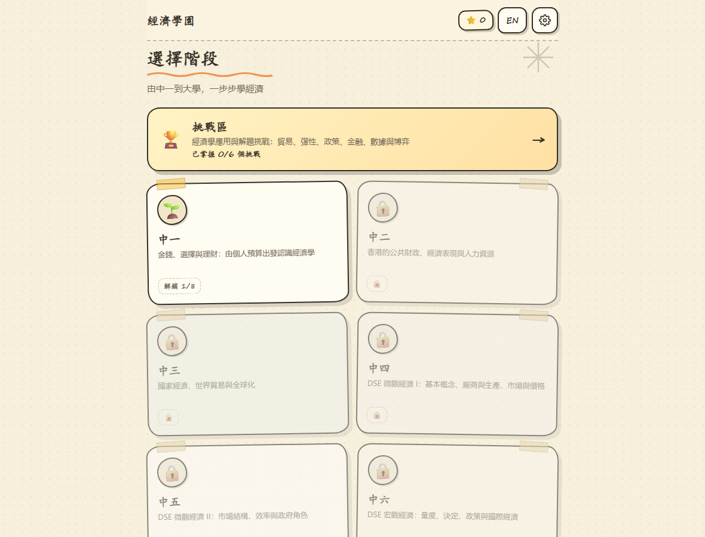
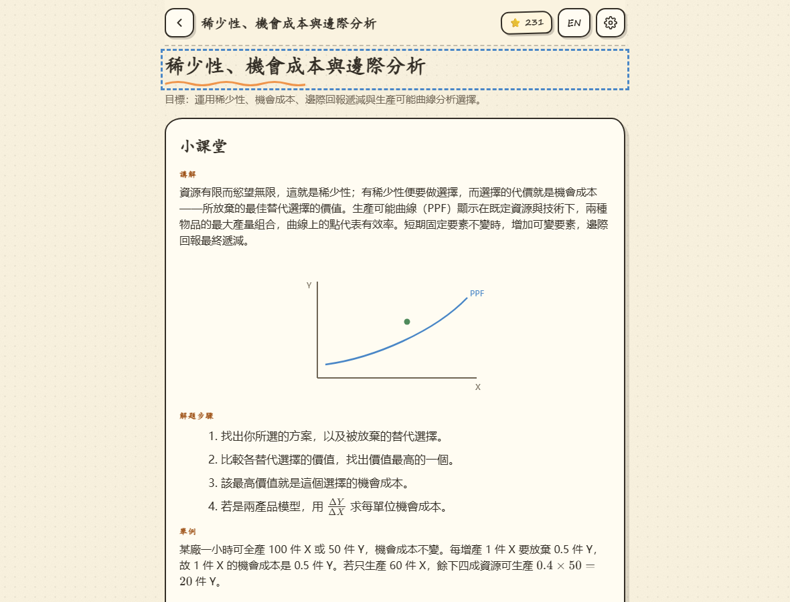
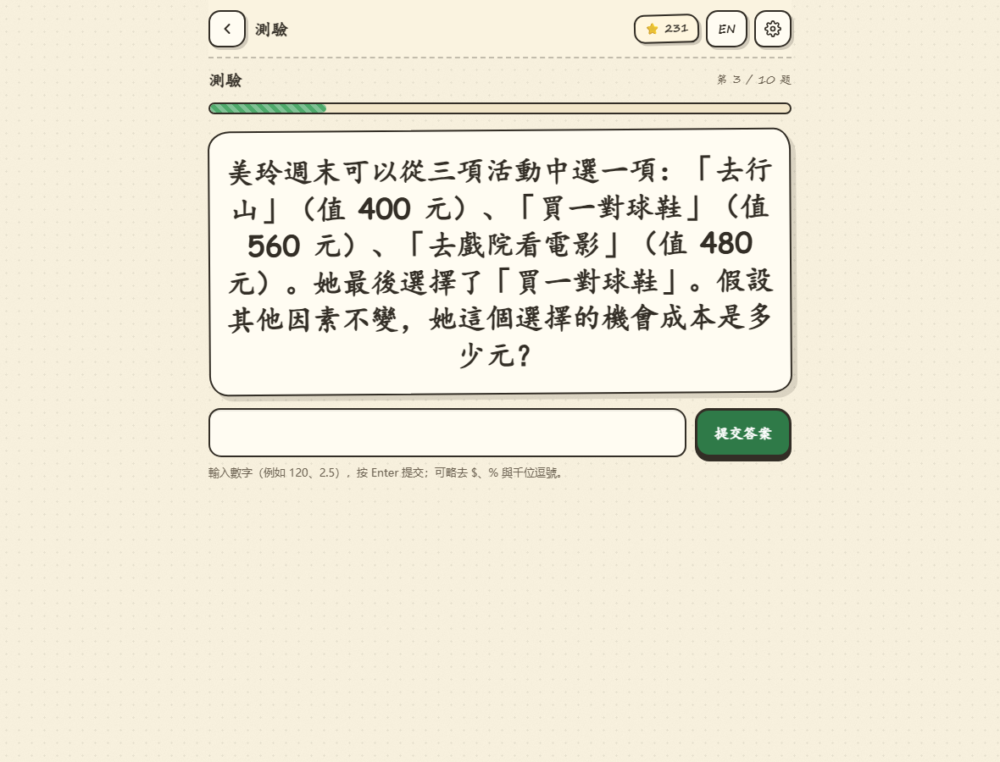
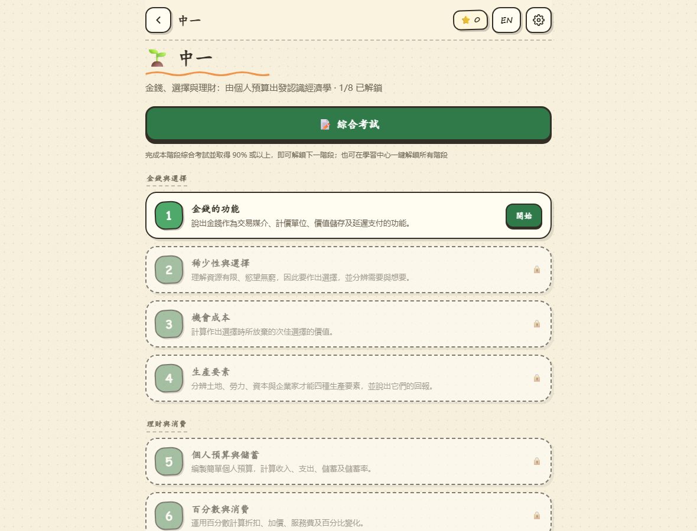

# 經濟學園 · Econ Garden

> 🌐 **線上版（任何裝置都能開）**：<https://carloswuwu.github.io/econ-garden/>

> 一個**完全離線**、可安裝到桌面／主屏幕的互動經濟學學習應用：由**中一**（公民、經濟與社會）一路學到**大學經濟學主修核心**，每課有雙語小課堂、隨機生成的計算練習、概念題庫、計分測驗與模擬試卷，進度保存在本機。

本 app 沿用「數學樂園 · Math Garden」成熟的介面與學習流程，內容、題型與課程則按香港經濟學課程重新編寫。**不設學前與小學階段**——因為正規經濟學教育由中一開始，詳見 [課程設計說明](docs/CURRICULUM-DESIGN.md)。

## 預覽

| 首頁（可看到整條中一至大學路徑） | 小課堂＋PPF 圖示 | DSE 鍵入答案題 |
| --- | --- | --- |
|  |  |  |
| **階段頁（逐步解鎖）** | **練習回饋** | **模擬考試結果** |
|  |  |  |

## 內容覆蓋

| 階段 | 課程依據 | 主題 | 技能數 |
| --- | --- | --- | --- |
| 🌱 中一 | 公民、經濟與社會（中一）理財教育＋經濟學入門 | 金錢與選擇、機會成本、生產要素、預算儲蓄、百分數、利息借貸、投資風險 | 8 |
| 🏙️ 中二 | 公民、經濟與社會（中二）公共財政、經濟表現 | 公共財政、稅種與累進稅、財政預算、GDP、增長、失業、通脹 | 8 |
| 🌏 中三 | 公民、經濟與社會（中三）國家經濟與世界貿易 | 國家經濟、比較優勢、全球化、匯率、關稅、國際收支、經濟體系、發展 | 8 |
| 🧭 中四 | DSE 經濟必修 A–C | 基本經濟概念與 PPF、廠商成本與利潤、需求供應與均衡、彈性 | 11 |
| ⚖️ 中五 | DSE 經濟必修 D–E＋要素市場 | 市場結構、完全競爭、壟斷、寡頭與博弈、價格歧視、盈餘、稅負、價格管制、外部性、公共財、工資 | 11 |
| 🏛️ 中六 | DSE 經濟必修 F–J＋選修延伸 | 國民收入、乘數、貨幣銀行、貨幣需求、宏觀問題、財政／貨幣／供應面政策、貿易理論、匯率、國際收支、增長發展 | 12 |
| 🎓 大學 | 大學經濟學主修核心 | 消費者／廠商理論、福利、博弈、資訊與行為、AD-AS／IS-LM、增長理論、貨幣理論、勞動、計量、公共、國際、經濟思想史 | 13 |
| 🏆 挑戰區 | 跨課題應用與解難 | 貿易與比較優勢、彈性與稅負、宏觀政策、財務數學、博弈與數據、經濟推理 | 6 |

> 合共 **77 個技能**：每個技能都有小課堂；計算技能由程式生成無限變化的題目；14 個概念技能設有雙語選擇題庫（共 126 題）。DSE 階段起，部分測驗／考試題目改為**鍵入答案**，避免靠猜。

## 怎麼開始

1. **線上使用**：開啟 <https://carloswuwu.github.io/econ-garden/>。
2. **雙擊 `play-econ.bat`**（Windows）：在乾淨的桌面應用窗口打開，無需聯網。
3. **雙擊 `index.html`**：用任何瀏覽器直接打開（classic scripts，無需 build）。
4. **安裝成 App（PWA）**：線上版或本機 HTTP（`node tests/serve.js`）都可以在 Chrome／Edge 點「安裝」，即可離線全屏使用；有新版本時會顯示更新按鈕。

> 進度存在瀏覽器 `localStorage`（`econpath.progress`）；學習中心可**導出／導入**進度，方便備份或換裝置。

## 功能特點

- 🧑‍🏫 **雙語小課堂**：每課有講解、舉例、小技巧、常見錯誤與詞彙表；計算課題另有解題步驟。全部課堂與介面可中英一鍵切換。
- 🧮 **生成式練習**：機會成本、PPF、供需均衡、各類彈性、稅負、盈餘、無謂損失、成本利潤、GDP、CPI、乘數、貨幣乘數、匯率、關稅、財務數學、Gini、回歸等，由程式按難度生成，答案是計算出來的而非硬編碼。
- 🧠 **概念題庫**：金錢功能、稀少性、生產要素、公共財政、全球化、經濟體系、實證／規範、三個基本經濟問題、生產、公共財、供應面政策、資訊／行為經濟學、經濟思想史、經濟推理等，以雙語選擇題訓練辨認與比較。
- 📈 **經濟學圖示**：供需圖（含曲線移動、價格上限／下限）、生產可能曲線、AD-AS 圖、棒形圖，以 SVG 顯示並附屏幕閱讀器文字替代。
- 📐 **公式一覽**：彈性、消費者／廠商、效率與政府、國民收入與乘數、貨幣與財務、國際貿易與金融、稅務與理財、統計計量，共 71 條公式以 KaTeX 排版。
- 📚 **課程大綱**：按香港初中「公民、經濟與社會」、DSE 經濟科（2025/26 優化後）及大學經濟學主修整理，並標示本 app 已覆蓋的技能。
- 🏆 **挑戰區**：首頁金色入口，永遠開放；6 個跨課題挑戰（貿易、彈性與稅負、宏觀政策、財務數學、博弈與數據、經濟推理）。
- ✍️ **防猜評估**：DSE／大學／挑戰階段每 3 題有 1 題改為鍵入答案；數字可含 `$`、`%`、千位逗號。
- 📝 **綜合考試**：每階段 20 題模擬試卷，跨技能抽題；90% 可解鎖下一階段（也可在首頁或學習中心一鍵解鎖所有階段）。
- ✍️ **自適應練習**：連續答對自動加難度、連續答錯自動降難度；只有第一次就答對才計入掌握度。
- 👨‍👩‍👦 **學習中心**：總星星、連續天數、各技能掌握度，導出／導入／重置進度。
- 🌗 淺色／深色自動切換，手機、平板、電腦都適配。
- ♿ 無障礙：每畫面單一 h1、鍵盤操作、對話框焦點陷阱、圖表文字替代、`aria-live` 回饋。
- 📴 無需安裝第三方套件、運行時無網絡請求；KaTeX 字型與程式已內嵌在 `vendor/`，離線可用。

## 階段與解鎖

- 首頁顯示**全部階段**（7 個年級階段＋挑戰區卡片）；未解鎖的階段變淡並顯示 🔒，點擊會提示先完成上一階段考試。
- 每個階段內技能順序解鎖：通過上一個技能的測驗（≥80%，2 星）才解鎖下一個。
- 完成階段綜合考試（≥90%）即解鎖下一階段；不想逐級解鎖，可在首頁按「🔓 解鎖所有階段」或在學習中心一鍵解鎖。
- 挑戰區永遠開放。

## 文件說明

| 文件 | 說明 |
| --- | --- |
| `index.html` | 頁面結構與腳本載入順序 |
| `style.css` | 手繪風界面樣式（沿用數學版，加入經濟學圖表與鎖定階段樣式） |
| `app.js` | 界面層（由數學版建置產物經 `tools/patch-app.js` 調整：品牌、儲存 key、階段、文字選項、首頁鎖定卡、經濟學圖表） |
| `econ-boot.js` | 內容註冊 API 與共用工具（可播種隨機數、數字選項、雙語題庫） |
| `econ-core.js` | 學習引擎：題目生成與組卷、判分、掌握度、自適應、進度清洗 |
| `i18n.js` | 界面中英文案 |
| `formulas.js` | 公式一覽（KaTeX） |
| `curriculum-outline.js` | 香港初中／DSE／大學課程大綱參考 |
| `content/stage-*.js` | 8 個階段的技能、主題、難度與題型設定 |
| `content/types-*.js` | 6 組題目生成器（微觀、廠商與市場、福利與干預、宏觀、稅務／匯率／預算、計量與財務） |
| `content/lessons-*.js` | 77 課雙語小課堂＋14 個概念技能題庫（126 題） |
| `docs/CURRICULUM-DESIGN.md` | 課程切分理由與官方文件依據（經濟學教育家角度） |
| `docs/TYPE-CATALOG.md` | 每個題型的生成器契約（給內容作者） |
| `docs/CONTENT-SPEC.md` | 課堂與題庫的格式、質量要求與分配 |
| `tests/dev-gen-check.js` | 生成器／課堂／題庫自動檢查（Node，無需瀏覽器） |
| `tests/ui-smoke.js` | jsdom 介面冒煙測試（可選） |
| `tests/browser-smoke.js` | 真實瀏覽器冒煙測試＋截圖（可選，需要 puppeteer-core） |
| `tests/a11y-smoke.js` | axe-core 無障礙檢查（可選，需要 puppeteer-core + axe-core） |
| `tests/offline-smoke.js` | PWA 離線重新載入測試（可選，配合 `tests/serve.js`） |
| `tests/qa/` | 生成器答案正確性稽核工具（獨立重算、邊界與頻率檢查；唯讀） |
| `tests/serve.js` | 極簡靜態伺服器（測試 PWA／離線） |
| `vendor/katex/` | KaTeX 排版（本地檔案，離線可用） |
| `manifest.webmanifest` / `sw.js` | PWA 清單與離線快取 |
| `play-econ.bat` | Windows 啟動器 |
| `tools/patch-app.js` | 從數學版 app.js 產生經濟學園界面層的可重跑補丁 |
| `tools/make-icons.ps1` | 重新生成應用圖標（Windows PowerShell + System.Drawing） |
| `THIRD-PARTY-NOTICES.md` | 第三方軟件授權（KaTeX MIT；完整條文在 `vendor/katex/LICENSE`） |

## 開發與測試

```bash
node tests/dev-gen-check.js          # 題型契約、答案、選項、解題步驟、課堂與題庫齊全度
node tests/ui-smoke.js               # jsdom 介面冒煙測試（需 jsdom；沒有會自動跳過）
node tests/browser-smoke.js          # 真實 Chrome/Edge 冒煙測試＋截圖（需 puppeteer-core，沒有會自動跳過）
node tests/a11y-smoke.js             # axe-core 無障礙檢查（serious/critical 0 違規）
node tests/serve.js                  # http://127.0.0.1:4173/（PWA／離線測試）
node tests/offline-smoke.js          # 先開 serve.js，再測 Service Worker 離線重新載入
```

> 可選測試依賴：`npm install`（jsdom、puppeteer-core）。沒有安裝時，相關測試會自動跳過；`dev-gen-check.js` 無需任何依賴。

- `tests/dev-gen-check.js` 會用 `vm` 依 `index.html` 順序載入全部內容，對每個技能 × 難度 × 題型抽樣 25 次，檢查：
  - 題幹／提示／解題步驟中英齊全；
  - 數字答案有限、文字答案在選項中；
  - 選項無重複、正確答案存在；
  - 題庫答案／選項 id 正確、每題雙語；
  - 組卷能出滿 10／20 題。
- 沒有 build step：`index.html` 以 classic `<script>` 載入，直接雙擊即可運行；修改內容後重新載入頁面即可。
- `app.js` 是由數學版建置產物打補丁而來；不要直接手改，改 `tools/patch-app.js` 後重新套用（需要先把原始 app.js 還原）。
- 圖標：`powershell -ExecutionPolicy Bypass -File tools/make-icons.ps1`。

## 課程設計與資料來源

- 教育局《公民、經濟與社會課程指引（中一至中三）》（2022）——經濟範疇、理財教育、公共財政、香港經濟表現、國家經濟與世界貿易。[連結](https://www.edb.gov.hk/attachment/tc/curriculum-development/kla/pshe/CESCG_c_20240730%20clean.pdf)
- 教育局《經濟課程及評估指引（中四至中六）》（2025 年更新；2025/26 學年起中四推行，適用於 2028 年起 HKDSE）：必修部分 10 個課題（A–J）＋兩個選修單元。[連結](https://amp.edb.edcity.hk/doc/chi/Econ.pdf)
- 考評局 HKDSE 經濟科評核安排。[連結](https://www.hkeaa.edu.hk/tc/hkdse/hkdse_subj.html?A1&1&9)
- 大學階段按本地大學經濟學主修常見核心課程整理（微觀、宏觀、計量、應用、思想史），只覆蓋入門核心，不取代大學課本。

## 部署

本專案沒有 build step；GitHub Pages 直接從 `main` 分支根目錄發佈（`.nojekyll` 已加入，避免 Jekyll 處理）。推送到 `main` 後會自動重新部署到 <https://carloswuwu.github.io/econ-garden/>。Service Worker、manifest 與 KaTeX 字型都用相對路徑，因此同一份檔案也可放在任何靜態主機或本機 `file://` 使用。

## 品質保證（本版本已跑）

| 檢查 | 結果 |
| --- | --- |
| `node tests/dev-gen-check.js` | ✓ 6,475 題抽樣，0 錯誤；77 課、14 題庫、49 個生成器契約齊全 |
| 獨立生成器稽核（`docs/QA-GENERATORS.md`） | ✓ 49/49 題型 PASS；7,920 題獨立重算，答案不符 0；修正後 25/25 定點回歸 PASS |
| 內容 QA（`docs/QA-CONTENT-1.md`、`docs/QA-CONTENT-2.md`） | 46 課＋31 課、86＋40 題逐項審核；共修正 33 個問題（定義、單位、方向、計錯、語文），全部數字例子重算 |
| `node tests/ui-smoke.js` | ✓ 36 項介面檢查（首頁、階段、課堂、練習、測驗、題庫、考試、公式、大綱） |
| `node tests/browser-smoke.js` | ✓ 37 項真實 Chrome 檢查＋截圖（含綜合考試通關、一鍵解鎖、設定、深色模式、挑戰區） |
| `node tests/a11y-smoke.js` | ✓ axe-core WCAG 2.1 AA：0 serious/critical 違規 |
| `node tests/offline-smoke.js` | ✓ Service Worker 離線重新載入＋離線開啟小課堂 |

> 稽核工具與報告都在 `tests/qa/` 與 `docs/`；所有答案均由獨立路徑重算，不是只檢查「有答案」。

## 授權

本專案目前**未附上專案層級的 LICENSE 檔**，因此預設為「版權所有」（公開 repo 不代表他人可自由使用、修改或再發佈）。第三方元件 KaTeX 以 MIT 授權，條文與版權聲明見 [`THIRD-PARTY-NOTICES.md`](THIRD-PARTY-NOTICES.md)。如要正式以開源方式分享，建議加入 MIT（寬鬆、最簡單）或 PolyForm Noncommercial 1.0.0（禁止商業使用）；詳見專案對話中的說明。

## 說明與限制

- 應用名稱「經濟學園 · Econ Garden」為暫定名，可在 `i18n.js`、`manifest.webmanifest` 和 `index.html` 的 `<title>` 修改。
- 課程大綱是參考整理，不是官方課程的完整複製；學校教學次序與選修安排可能不同。
- 經濟學部分課題（最低工資、貿易保護、再分配等）涉及價值判斷；app 只呈現主流經濟學的分析與取捨，不為特定政治立場背書。
- 語音朗讀暫未內置；離線安裝需 HTTPS 或 `localhost`（直接雙擊 `file://` 仍可完整使用，只是不註冊 Service Worker）。
- 介面骨架來自「數學樂園 · Math Garden」；經濟學課程、生成器、課堂、公式與大綱為本專案新寫。
